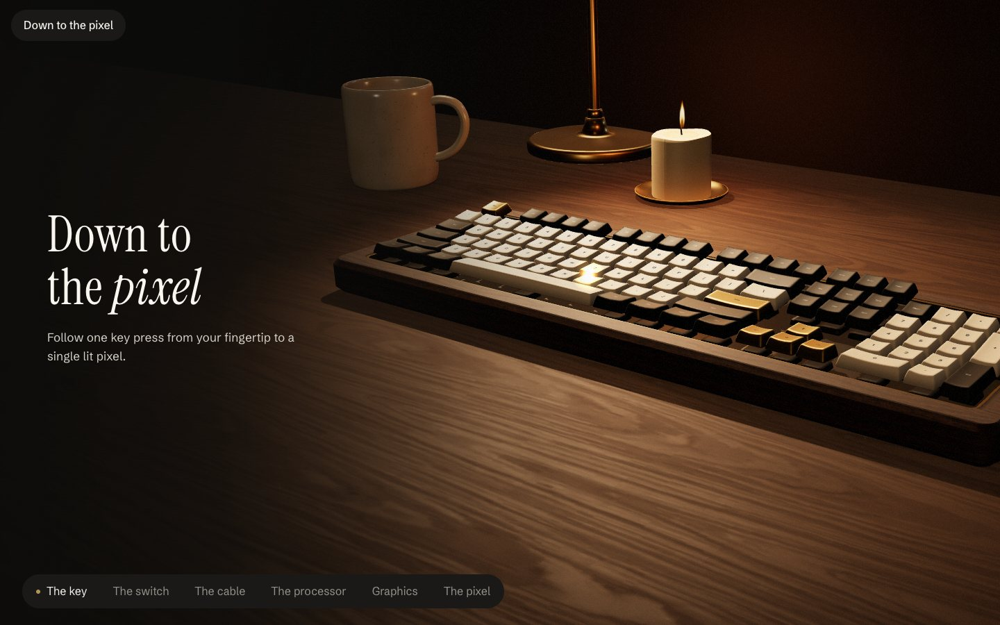
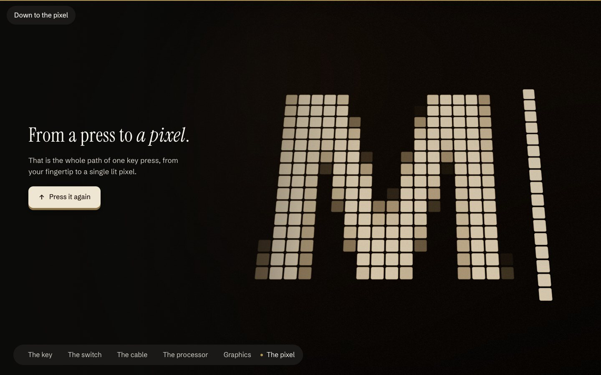

# Down to the pixel

Follow one key press from your fingertip to a single lit pixel, in one continuous scroll.

**Live:** https://down-to-the-pixel.pages.dev



## What it shows

Six stops, one camera move from start to finish:

1. **The key.** The M key on a walnut keyboard goes down; a gauge shows where the press registers.
2. **The switch.** The switch opens up: the stem, the spring and the two contacts that close the circuit.
3. **The cable.** The message runs down the lead, through the braid, the foil shield and the twisted data pair, into the plug.
4. **The processor.** Copper tracks carry it across the main board; the metal lid lifts and the silicon lights up, block by block.
5. **Graphics.** Through the chip's light into the dark: the letter's outline is traced from the font, a grid of pixels is laid over it, and the covered pixels rise.
6. **The pixel.** The pixels become a screen, and one of them opens into its red, green and blue lights.

It ends on the whole letter, with a cursor blinking after it.

Along the way: every labelled part opens a short definition, every stop has a "Go deeper" panel, the stop list jumps anywhere, and the arrow keys step through the story one moment at a time. Every figure on the page has a source in [`docs/sources.md`](docs/sources.md).



## Built with

Astro 7, TypeScript and Three.js, with hand-written shaders. Everything in the scene is built in code except three CC0 textures from Poly Haven (see [`CREDITS.md`](CREDITS.md)). Static files on Cloudflare Pages, with security headers and an enforced Content Security Policy (`public/_headers`).

It holds 60 fps on a recent laptop. The later stops' shaders and textures are warmed up while you are still on the desk, so the first scroll into them doesn't stall. Reduced motion shows still frames, and without WebGL or JavaScript the words read as a plain article.

## Run it locally

Needs Node 22 or newer.

```bash
npm install
npm run dev       # http://localhost:4321
npm run check     # type check, build, unit tests
npm run deploy    # build and upload to Cloudflare Pages (needs `npx wrangler login`)
```

Add `?p=0.5` to the URL to pin the walk at any point, and `?debug` for a readout of progress and draw calls.

## Where things live

- `src/scripts/choreo/timeline.ts`: every camera shot, part timing and text switch, as plain data.
- `src/scripts/walk.js`: the scene, the camera rig and the frame loop.
- `src/scripts/three/stops/`: one module per stop (`board.ts`, `corner.ts`, `cable.ts`, `cpu.ts`, `gfx.ts`).
- `src/pages/index.astro`: the words. `src/styles/global.css`: the look.
- `tools/`: screenshot, performance and console checks.
- `AGENTS.md`: how it fits together and the rules for changing it.
